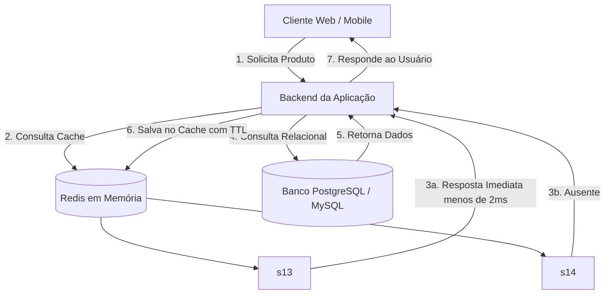

## 👨‍🏫 Metadados e Informações Acadêmicas
- **Instituição:** Faculdade de Tecnologia de Ferraz de Vasconcelos (FATEC-FV)
- **Curso:** Análise e Desenvolvimento de Sistemas (ADS)
- **Disciplina:** Tópicos em Banco de Dados e Big Data
- **Professor Orientador:** Prof. Francisco Abreu
- **Pesquisador / Desenvolvedor:** Josias Sobrinho
- **Projeto Base:** Atividade prática com Redis (NoSQL Chave-Valor & Armazenamento em Memória)

# 🚀 Atividade Prática: Introdução ao Redis com Docker

> [!IMPORTANT]
> **Ambiente de Execução:** Este roteiro foi elaborado e validado em ambiente Linux com Docker e Docker Compose. Em sistemas Windows ou macOS, os comandos do Redis e do Docker funcionam da mesma maneira, com pequenas variações apenas no terminal utilizado (PowerShell / Bash / WSL2).

---

## 🎯 Objetivos da Atividade

1. Provisionar uma instância local do **Redis 7 (Alpine)** via **Docker Compose** com autenticação protegida por senha e persistência de dados em volume.
2. Compreender a arquitetura em memória do Redis e seus mecanismos de durabilidade em disco (**RDB** e **AOF**).
3. Dominar a manipulação das principais estruturas de dados NoSQL:
   - **Strings** (armazenamento simples e contadores atômicos);
   - **Hashes** (objetos e dicionários de campos);
   - **Lists** (filas e pilhas ordenadas);
   - **Sets** (conjuntos de valores únicos);
   - **Sorted Sets (ZSET)** (conjuntos ordenados por pontuação).
4. Gerenciar políticas de expiração de dados com **TTL** (*Time-To-Live*).
5. Aplicar padrões de arquitetura de software e e-commerce de alta performance:
   - Estratégia de **Cache-Aside** (*Cache Hit* e *Cache Miss*);
   - **Idempotência** em transações de pagamento;
   - Controle atômico de concorrência em estoque (*anti-overbooking*);
   - Gerenciamento de sessões e carrinhos temporários;
   - Construção de **Leaderboards** (Rankings em tempo real);
   - **Rate Limiting** para proteção contra requisições abusivas e robôs.
6. Aplicar boas práticas de segurança e administração para ambientes de produção.

---

## 📋 1. Configuração do Docker Compose

O **Redis** (*Remote Dictionary Server*) é um armazenamento de estrutura de dados em memória de altíssimo desempenho, amplamente utilizado como banco de dados NoSQL, cache distribuído e *message broker*.

Para este laboratório, utilizaremos o arquivo `docker-compose.yml` para subir um container com persistência em volume e senha configurada.

```yaml
version: '3.8'

services:
  redis:
    image: redis:7.0-alpine
    container_name: redis-cache
    restart: always
    ports:
      - "6378:6379" # Mapeia a porta 6379 do container na porta 6378 da máquina host
    command: redis-server --requirepass sua_senha_segura_aqui
    volumes:
      - redis_data:/data
    networks:
      - redis-network

volumes:
  redis_data:

networks:
  redis-network:
    driver: bridge
```

> [!NOTE]
> **Explicação detalhada dos parâmetros:**
> - `image: redis:7.0-alpine`: Utiliza a versão oficial do Redis 7 baseada no Alpine Linux, gerando uma imagem compacta e rápida para download e execução.
> - `container_name: redis-cache`: Nome fixo para facilitar os comandos de execução e inspeção no Docker.
> - `restart: always`: Configura o container para reiniciar automaticamente se for encerrado de forma inesperada ou após a reinicialização do sistema operacional.
> - `ports: - "6378:6379"`: Redireciona a porta padrão interna do Redis (`6379`) para a porta `6378` da máquina host. *(Observação: caso a porta padrão `6379` esteja livre na sua máquina local, você pode usar `"6379:6379"`)*.
> - `command: redis-server --requirepass sua_senha_segura_aqui`: Inicia o servidor exigindo autenticação obrigatória via senha para qualquer cliente conectado.
> - `volumes: redis_data:/data`: Monta um volume nomeado no diretório `/data` do Redis, preservando os arquivos de despejo (*dump.rdb*) entre reinicializações do container.

---

## 🐳 2. Execução e Conexão ao Container

### 2.1. Inicializar o serviço em segundo plano

No terminal, dentro da pasta onde está o arquivo `docker-compose.yml`, execute:

```bash
docker compose up -d
```

Para validar se o container está ativo e saudável:

```bash
docker ps --filter "name=redis-cache"
```

---

### 2.2. Acessar o terminal interativo do Redis (`redis-cli`)

Você pode acessar o terminal interativo de duas formas:

#### Opção A: Acesso com autenticação interativa (Recomendado para evitar avisos)
```bash
docker exec -it redis-cache redis-cli
```
Dentro do prompt do Redis, execute o comando de autenticação:
```text
127.0.0.1:6379> AUTH sua_senha_segura_aqui
OK
```

#### Opção B: Acesso direto com senha na linha de comando
```bash
docker exec -it redis-cache redis-cli -a sua_senha_segura_aqui --no-auth-warning
```

#### Teste de Conexão:
Envie um comando de eco para confirmar a resposta do servidor:
```text
127.0.0.1:6379> PING
PONG
```

---

## 🔑 3. Estruturas de Dados Fundamentais e Comandos Práticos

O Redis organiza os dados em chave-valor, suportando estruturas ricas. A seguir estão os comandos essenciais para o aprendizado prático:

### 3.1. Gerenciamento de Chaves e Strings

Strings são os tipos de dados mais elementares do Redis, suportando desde textos e JSONs serializados até valores inteiros e pontos flutuantes de até 512 MB.

| Comando | Descrição | Sintaxe |
| :--- | :--- | :--- |
| `SET` | Salva um valor associado a uma chave | `SET <chave> <valor>` |
| `GET` | Recupera o valor de uma chave | `GET <chave>` |
| `MSET` | Salva múltiplas chaves simultaneamente | `MSET <ch1> <val1> <ch2> <val2>` |
| `MGET` | Recupera múltiplas chaves de uma só vez | `MGET <ch1> <ch2>` |
| `EXISTS` | Verifica se a chave existe (retorna `1` ou `0`) | `EXISTS <chave>` |
| `DEL` | Exclui uma ou mais chaves | `DEL <chave>` |
| `INCR` | Incrementa o valor numérico em +1 (atômico) | `INCR <chave>` |
| `DECR` | Decrementa o valor numérico em -1 (atômico) | `DECR <chave>` |
| `INCRBY` | Incrementa um valor por um passo determinado | `INCRBY <chave> <incremento>` |

#### Prática no terminal:
```text
127.0.0.1:6379> SET usuario:nome "Carlos Silva"
OK

127.0.0.1:6379> GET usuario:nome
"Carlos Silva"

127.0.0.1:6379> EXISTS usuario:nome
(integer) 1

127.0.0.1:6379> SET contador:acessos 10
OK

127.0.0.1:6379> INCR contador:acessos
(integer) 11

127.0.0.1:6379> INCRBY contador:acessos 5
(integer) 16

127.0.0.1:6379> DEL usuario:nome
(integer) 1
```

---

### 3.2. Gerenciamento de Tempo de Vida (TTL - Time-To-Live)

O TTL permite que o Redis expire e descarte chaves automaticamente após determinado intervalo. Esse recurso é a base para soluções eficientes de **cache**, **tokens de autenticação** e **bloqueios temporários**.

| Comando | Descrição | Retorno |
| :--- | :--- | :--- |
| `EXPIRE <chave> <seg>` | Define tempo de expiração em segundos | `(integer) 1` (sucesso) ou `0` |
| `TTL <chave>` | Retorna os segundos restantes para expiração | Tempo restante, `-1` (sem expiração) ou `-2` (inexistente) |
| `SETEX <chave> <seg> <val>` | Atalho atômico: cria a chave e define o TTL | `OK` |
| `PERSIST <chave>` | Remove a expiração, tornando a chave persistente | `(integer) 1` ou `0` |

#### Prática no terminal:
```text
# Cria um token temporário com duração de 60 segundos
127.0.0.1:6379> SETEX token:recuperacao 60 "ABC-987-XYZ"
OK

# Consulta o tempo de vida restante
127.0.0.1:6379> TTL token:recuperacao
(integer) 54

# Remove a expiração para torná-la permanente
127.0.0.1:6379> PERSIST token:recuperacao
(integer) 1

127.0.0.1:6379> TTL token:recuperacao
(integer) -1
```

---

### 3.3. Hashes (Objetos e Dicionários)

Hashes são mapeamentos entre campos de strings e valores de strings. São perfeitos para representar modelos e objetos de negócio (como usuários, clientes e produtos) sem a necessidade de serializar/deserializar todo o JSON a cada alteração de campo.

| Comando | Descrição | Sintaxe |
| :--- | :--- | :--- |
| `HSET` | Define um ou mais campos de um hash | `HSET <chave> <campo> <valor> [...]` |
| `HGET` | Retorna o valor de um campo específico | `HGET <chave> <campo>` |
| `HMGET` | Retorna valores de múltiplos campos | `HMGET <chave> <campo1> <campo2>` |
| `HGETALL` | Retorna todos os campos e valores do hash | `HGETALL <chave>` |
| `HDEL` | Remove campos específicos do hash | `HDEL <chave> <campo>` |
| `HEXISTS` | Verifica se um campo existe no hash | `HEXISTS <chave> <campo>` |

#### Prática no terminal:
```text
127.0.0.1:6379> HSET produto:1001 nome "Teclado Mecânico" preco "299.90" estoque "15"
(integer) 3

127.0.0.1:6379> HGET produto:1001 nome
"Teclado Mecânico"

127.0.0.1:6379> HMGET produto:1001 preco estoque
1) "299.90"
2) "15"

127.0.0.1:6379> HGETALL produto:1001
1) "nome"
2) "Teclado Mecânico"
3) "preco"
4) "299.90"
5) "estoque"
6) "15"
```

---

### 3.4. Listas (Filas e Pilhas)

Listas no Redis são sequências ordenadas de strings baseadas em listas duplamente ligadas (*linked lists*). As inserções no início e no fim têm custo de tempo constante $O(1)$, tornando-as excelentes para filas de mensageria e logs recentes.

| Comando | Descrição | Sintaxe |
| :--- | :--- | :--- |
| `LPUSH` | Insere elementos no início (esquerda / topo) | `LPUSH <lista> <valor>` |
| `RPUSH` | Insere elementos no fim (direita / cauda) | `RPUSH <lista> <valor>` |
| `LRANGE` | Consulta elementos por índice (`0 -1` traz todos) | `LRANGE <lista> <inicio> <fim>` |
| `LPOP` | Remove e retorna o primeiro elemento (FIFO ou LIFO) | `LPOP <lista>` |
| `RPOP` | Remove e retorna o último elemento | `RPOP <lista>` |
| `LLEN` | Retorna o tamanho total da lista | `LLEN <lista>` |

#### Prática no terminal:
```text
# Inserindo pedidos na fila de processamento (FIFO)
127.0.0.1:6379> RPUSH fila:pedidos "pedido_#001" "pedido_#002" "pedido_#003"
(integer) 3

# Consultando todos os itens da fila
127.0.0.1:6379> LRANGE fila:pedidos 0 -1
1) "pedido_#001"
2) "pedido_#002"
3) "pedido_#003"

# Consumindo o primeiro item da fila
127.0.0.1:6379> LPOP fila:pedidos
"pedido_#001"
```

---

### 3.5. Conjuntos (Sets - Valores Únicos Não Ordenados)

Sets são coleções de strings sem ordem predefinida que **garantem unicidade** (não admitem duplicatas). Possuem operações eficientes de pertinência, união, interseção e diferença.

| Comando | Descrição | Sintaxe |
| :--- | :--- | :--- |
| `SADD` | Adiciona um ou mais membros ao conjunto | `SADD <conjunto> <membro>` |
| `SMEMBERS` | Retorna todos os membros do conjunto | `SMEMBERS <conjunto>` |
| `SISMEMBER` | Verifica se um item pertence ao conjunto (retorna `1` ou `0`) | `SISMEMBER <conjunto> <membro>` |
| `SREM` | Remove um membro do conjunto | `SREM <conjunto> <membro>` |
| `SCARD` | Retorna a contagem de elementos do conjunto | `SCARD <conjunto>` |

#### Prática no terminal:
```text
# Registrando tags de um produto ou usuários online
127.0.0.1:6379> SADD usuarios:online "user_10" "user_25" "user_99" "user_10"
(integer) 3 # Repare que user_10 foi inserido apenas uma vez

127.0.0.1:6379> SISMEMBER usuarios:online "user_25"
(integer) 1

127.0.0.1:6379> SMEMBERS usuarios:online
1) "user_99"
2) "user_10"
3) "user_25"
```

---

### 3.6. Conjuntos Ordenados (Sorted Sets / ZSET)

São conjuntos onde cada item é associado a uma pontuação flutuante (*score*). Os elementos permanecem automaticamente ordenados pela sua pontuação. É a estrutura clássica para tabelas de pontuação (*leaderboards*), sistemas de recomendação e índices secundários.

| Comando | Descrição | Sintaxe |
| :--- | :--- | :--- |
| `ZADD` | Adiciona membros com respectiva pontuação | `ZADD <chave> <score> <membro>` |
| `ZINCRBY` | Incrementa o score de um membro existente | `ZINCRBY <chave> <incremento> <membro>` |
| `ZRANGE` | Retorna membros por posição (menor para maior) | `ZRANGE <chave> <ini> <fim> [WITHSCORES]` |
| `ZREVRANGE` | Retorna membros ordenados do maior para o menor | `ZREVRANGE <chave> <ini> <fim> [WITHSCORES]` |
| `ZSCORE` | Retorna a pontuação de um membro | `ZSCORE <chave> <membro>` |

#### Prática no terminal:
```text
# Criando um ranking de vendas com pontuação inicial
127.0.0.1:6379> ZADD mais_vendidos 50 "mouse_gamer" 120 "teclado_mecanico" 85 "headset"
(integer) 3

# Incrementando 30 vendas para o headset
127.0.0.1:6379> ZINCRBY mais_vendidos 30 "headset"
"115"

# Recuperando o Top 3 produtos mais vendidos com suas respectivas pontuações
127.0.0.1:6379> ZREVRANGE mais_vendidos 0 2 WITHSCORES
1) "teclado_mecanico"
2) "120"
3) "headset"
4) "115"
5) "mouse_gamer"
6) "50"
```

---

## ⚙️ 4. Administração, Diagnóstico e Boas Práticas

### 4.1. ⚠️ Por que NUNCA usar `KEYS *` em Produção?

O Redis processa comandos através de um único loop de eventos (*single-threaded*). O comando `KEYS *` realiza uma varredura completa (bloqueante) na memória:

> [!WARNING]
> Em bases de dados de produção com milhões de chaves, `KEYS *` trava o servidor por vários segundos ou minutos, enfileirando e derrubando todas as requisições da sua aplicação.

#### A Alternativa Segura: `SCAN`
O comando `SCAN` itera sobre a base utilizando um cursor não-bloqueante:

```text
# Inicia no cursor 0, filtrando pelo padrão desejado
127.0.0.1:6379> SCAN 0 MATCH produto:* COUNT 10
1) "17" # Próximo cursor retornado
2) 1) "produto:1001"
   2) "produto:1002"
```

---

### 4.2. Monitoramento e Informações do Servidor

```bash
# Exibe métricas de uso de memória, conexões ativas e status de persistência
INFO

# Informações resumidas apenas sobre memória
INFO memory

# Contagem total de chaves do banco atual
DBSIZE

# Testa a latência do servidor (em milissegundos)
PING
```

---

### 4.3. Persistência: RDB vs. AOF

Por padrão, o Redis opera primariamente em memória, oferecendo duas estratégias complementares de persistência para disco:

1. **RDB (Redis Database Backup):** Tira instantâneos compactos pontuais (*snapshots*) da memória e salva no arquivo `dump.rdb` em intervalos configurados (ex: a cada 15 minutos se houver alterações).
2. **AOF (Append Only File):** Registra um log sequencial de cada comando de escrita executado. Se houver falha de energia, o Redis refaz as instruções no boot sem perda perceptível de dados.

> [!TIP]
> No arquivo `docker-compose.yml`, todo o diretório `/data` está montado no volume `redis_data`, o que garante que tanto arquivos RDB quanto logs AOF persistam de forma transparente entre as execuções dos containers.

---

## 🛒 5. Padrões de Projeto e Casos de Uso Reais em E-commerce

No comércio eletrônico, alta disponibilidade, consistência e tempos de resposta inferiores a 5 milissegundos são vitais para evitar carrinhos abandonados e indisponibilidade de serviços durante eventos como a *Black Friday*.



---

### 5.1. Padrão Cache-Aside (Catálogo de Produtos)

Evita sobrecarregar os bancos relacionais com consultas repetitivas de páginas de produtos visitadas com frequência.

- **Cache Hit:** O item solicitado está salvo na memória rápida do Redis e é entregue quase instantaneamente.
- **Cache Miss:** O item não se encontra no Redis; a aplicação o busca no banco relacional principal, popula o Redis com um TTL razoável e devolve os dados ao cliente.

#### Exemplo em Python (Pseudocódigo de Aplicação):
```python
import redis
import json

# Conexão com o Redis (porta mapeada 6378 do host)
r = redis.Redis(host='localhost', port=6378, password='sua_senha_segura_aqui', decode_responses=True)

def obter_detalhes_produto(id_produto: int):
    chave_cache = f"produto:{id_produto}"
    
    # 1. Tenta buscar no Redis
    produto_cache = r.get(chave_cache)
    
    if produto_cache:
        print("⚡ Cache Hit! Entregando diretamente do Redis.")
        return json.loads(produto_cache)
    
    # 2. Em caso de Cache Miss, busca no banco relacional
    print("🐢 Cache Miss! Consultando banco de dados principal (PostgreSQL/MySQL)...")
    produto_banco = banco_relacional.query("SELECT * FROM produtos WHERE id = %s", id_produto)
    
    # 3. Armazena no Redis com expiração automática de 1 hora (3600 segundos)
    r.setex(chave_cache, 3600, json.dumps(produto_banco))
    
    return produto_banco
```

---

### 5.2. Idempotência em Pagamentos (Prevenção de Cobranças Duplicadas)

Quando uma conexão de internet oscila, o usuário pode clicar repetidamente no botão "Pagar Agora". A idempotência garante que a cobrança execute uma única vez.

O segredo consiste na instrução atômica `SET` com as opções `NX` (*Not Exists*) e `EX` (*Expire*):

```bash
# Tenta registrar o lock da transação com expiração de 30 segundos
SET lock:pagamento:transacao_987654 "processando" NX EX 30
```

- **Se o retorno for `OK`:** A requisição obteve a trava de execução com exclusividade e o pagamento pode ser debitado.
- **Se o retorno for `(nil)`:** A transação já está sendo processada por outra chamada. A requisição concorrente é rejeitada imediatamente com HTTP `409 Conflict`.

---

### 5.3. Concorrência e Estoque Atômico (Anti-Overbooking)

Se houver apenas 1 unidade de um item promocional e 100 clientes tentarem comprá-la no mesmo milissegundo, leituras tradicionais de banco de dados (`SELECT estoque ...`) geram **condição de corrida** (*Race Condition*), vendendo produtos que não existem.

Como o Redis executa cada instrução de forma atômica e sequencial, utilizamos o comando `DECR`:

```text
# Saldo inicial de 1 item no estoque
127.0.0.1:6379> SET estoque:ps5:id_99 1
OK

# Requisição A (Chegou primeiro)
127.0.0.1:6379> DECR estoque:ps5:id_99
(integer) 0  # -> Compra autorizada!

# Requisição B (Chegou 1 milissegundo depois)
127.0.0.1:6379> DECR estoque:ps5:id_99
(integer) -1 # -> Estoque esgotado! Desfaz com INCR e avisa que esgotou.
```

---

### 5.4. Sessões de Usuário e Carrinho com Descarte Automático

Em vez de sobrecarregar tabelas relacionais com carrinhos de compra que podem nunca ser finalizados, o carrinho é mantido como um Hash ou JSON no Redis com TTL de 24 horas:

```bash
# Salva o carrinho do cliente e estabelece o tempo de expiração (86400 segundos = 24h)
SETEX carrinho:usuario:456 86400 '{"itens": [{"id": 101, "qtd": 1}, {"id": 202, "qtd": 2}]}'
```

Se o cliente abandona o site, o Redis descarta o registro por conta própria, liberando memória sem necessidade de rotinas periódicas pesadas (*cron jobs*) no banco principal.

---

### 5.5. Rate Limiting (Proteção contra Abusos e Fraudes)

Evita que scripts maliciosos tentem fraudar cupons de desconto ou descubram dados de cartões por força bruta (*brute-force*).

```text
# Registra tentativa e incrementa contador do IP
127.0.0.1:6379> INCR rate:checkout:ip_192.168.1.50
(integer) 1

# No primeiro acesso, define uma janela de tolerância de 60 segundos
127.0.0.1:6379> EXPIRE rate:checkout:ip_192.168.1.50 60
(integer) 1
```

Se o retorno de `INCR` ultrapassar o limite estabelecido (por exemplo, mais de 10 tentativas em 60 segundos), o gateway rejeita as requisições temporariamente com HTTP `429 Too Many Requests`.

---

## 🧩 6. Desafios Práticos (Para Fixação)

Coloque o aprendizado em prática executando os exercícios diretamente no terminal do Redis:

### Desafio 1: Sistema de Cupom com Limite de Usos
1. Crie uma chave de controle de estoque chamada `cupom:desconto:blackfriday` com o valor numérico inicial `3`.
2. Simule 4 tentativas consecutivas de resgate utilizando a operação atômica de decremento.
3. Garanta que a quarta tentativa identifique que o cupom se esgotou e reverta o saldo para zero.

### Desafio 2: Fila de Tarefas Assíncronas para Envio de E-mails
1. Adicione três e-mails de clientes na fila `fila:boas_vindas` utilizando `RPUSH`.
2. Inspecione todos os e-mails da fila com `LRANGE`.
3. Processe os e-mails um por um até esvaziar a lista utilizando `LPOP`.

### Desafio 3: Carrinho de Compras em Hash com Expiração
1. Registre um carrinho com o ID `carrinho:sessao:888` utilizando a estrutura `HSET` contendo os campos: `cliente_id`, `data_criacao` e `total`.
2. Configure uma expiração automática de 120 segundos para esse carrinho com `EXPIRE`.
3. Verifique o tempo restante com `TTL`.

---

## 🛑 7. Encerramento e Limpeza do Ambiente

Quando concluir as atividades práticas, utilize os comandos do Docker Compose para controlar os recursos da sua máquina:

```bash
# 1. Parar o serviço mantendo intactos os dados armazenados no volume
docker compose down

# 2. Reiniciar o serviço quando voltar a estudar
docker compose up -d

# 3. ATENÇÃO: Para remover o container E DELETAR definitivamente os volumes de dados
docker compose down -v
```

---

## 📚 Referências e Links Úteis
- [Documentação Oficial do Redis](https://redis.io/docs/)
- [Redis Commands Reference](https://redis.io/commands/)
- [Docker Hub - Imagem Oficial Redis](https://hub.docker.com/_/redis)
